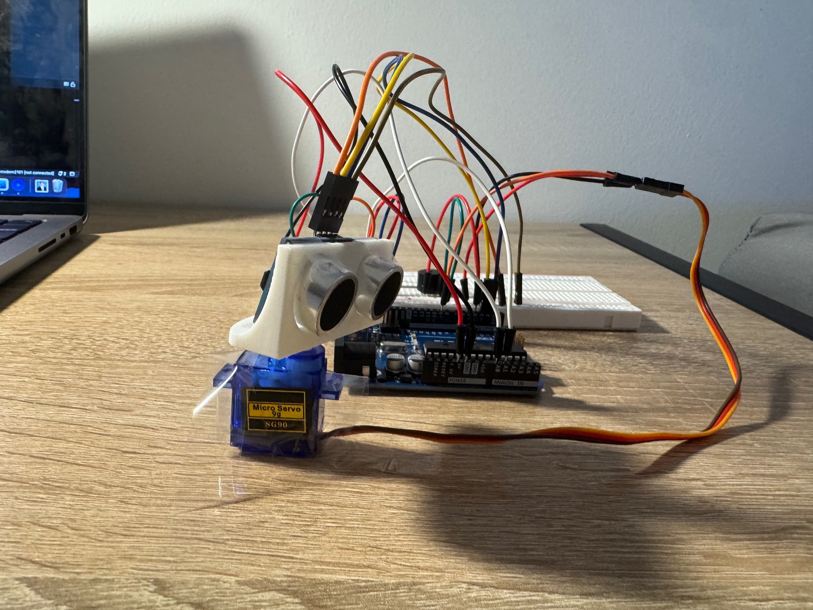
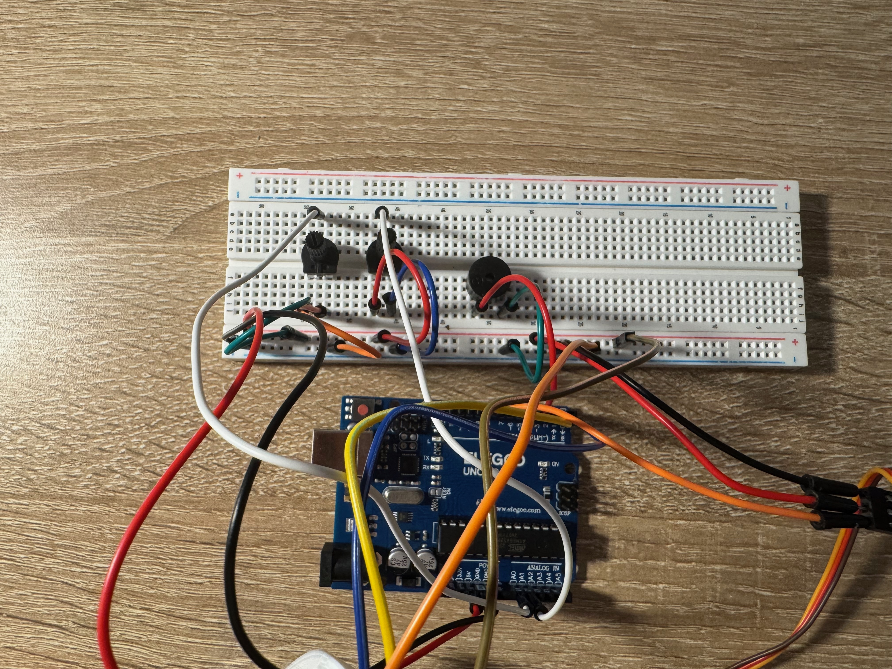
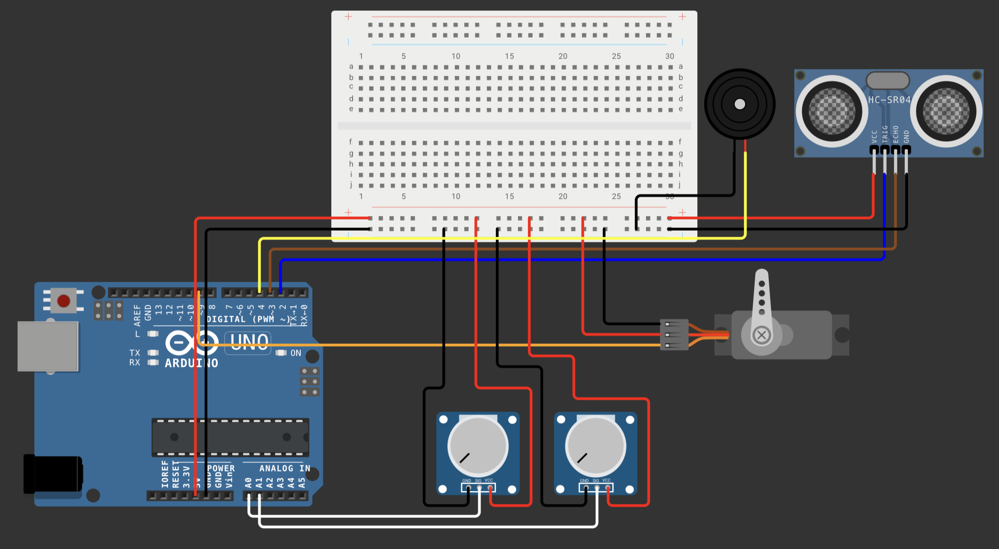

# Arduino Ultrasonic Radar System

An Arduino-based radar system that detects nearby objects using an HC-SR04 ultrasonic sensor mounted on a servo motor. The system displays real-time distance measurements in a radar interface built with Processing (Java).

Two potentiometers provide physical control over scanning speed and detection range, while a buzzer produces different alert patterns depending on the detected object's distance zone.

**Technologies:** Arduino, C++, Processing (Java), Ultrasonic Sensors, Serial Communication

## Project Demonstration

[Watch the Project Demonstration](Media/demo.mp4)

## Features

- **Ultrasonic scanning:** Servo-mounted HC-SR04 sensor sweeps back and forth to detect nearby objects.
- **Adjustable scanning speed:** Potentiometer controls how quickly the servo sweeps.
- **Adjustable radar range:** Second potentiometer adjusts the displayed detection range from 100 cm to 300 cm.
- **Visual radar display:** Processing displays a green scanning beam, adjustable distance rings, and red object detections.
- **Audible proximity alerts:** Buzzer beeps faster for detections in the inner radar rings and slower for those in the outer rings.
- **Serial communication:** Arduino sends angle, distance, and radar settings to Processing over USB.

## Hardware Components

- Arduino Uno
- HC-SR04 ultrasonic sensor
- SG90 micro servo motor
- 2 potentiometers
- Buzzer
- Breadboard and jumper wires

### Hardware Setup

### Wiring Diagram

| Component | Arduino Pin |
|---|---|
| Servo signal | D9 |
| Buzzer | D4 |
| Ultrasonic TRIG | D2 |
| Ultrasonic ECHO | D3 |
| Speed potentiometer | A0 |
| Range potentiometer | A1 |

Both potentiometers connect to 5V and GND through their outer terminals, with their center terminals connected to the analog inputs. The components share a common ground.

## How It Works

1. The Arduino reads the potentiometers to determine scanning speed and radar range.
2. The servo rotates the ultrasonic sensor across a scanning arc.
3. The ultrasonic sensor measures distance using reflected sound waves.
4. The Arduino determines the buzzer alert pattern based on one of four radar distance zones.
5. Sensor measurements and servo position are transmitted to Processing through USB serial communication.
6. Processing converts the measurements into a real-time radar visualization.

## Software

The project uses two programs:

**Arduino (`radar.ino`)**

Controls servo movement, ultrasonic measurements, potentiometer inputs, buzzer patterns, and serial data transmission.

**Processing (`SonarRadar.pde`)**

Receives Arduino data and displays the scanning beam, distance rings, and detected objects.

Both programs communicate at 9600 baud.

## Running the Project

1. Assemble the circuit using the wiring diagram.
2. Open and upload the Arduino sketch using the Arduino IDE.
3. Open the Processing sketch in Processing's Java Mode.
4. Update the serial port in the Processing code to match your Arduino.
5. Close the Arduino Serial Monitor and run the Processing sketch.
6. Adjust the potentiometers to control scanning speed and radar range.

## Challenges and Improvements

During development, I worked on improving servo movement, aligning the Processing radar sweep with the physical servo angle, and synchronizing sensor measurements through serial communication.

The project also involved balancing scanning speed with reliable ultrasonic readings and implementing a four-zone proximity alert system.

## Future Improvements

- Improve ultrasonic measurement filtering.
- Test and document distance accuracy.
- Add data logging for recorded scans.
- Improve the mechanical mounting and power delivery for the servo.

## Project Media

- [Project Photo](Media/radar-project.jpeg)
- [Hardware Close-up](Media/hardware.jpeg)
- [Circuit Diagram](Hardware/wiring-diagram.png)
- [Demonstration Video](Media/demo.mp4)
